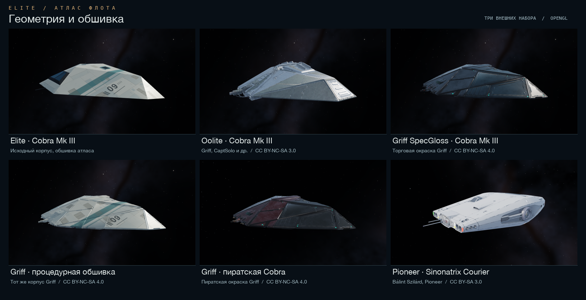

# ZX Elite GFX

A just-for-fun tribute to the ZX Spectrum version of *Elite* and the community that keeps it flying.

The **wireframe lab** lets you follow a ship's edge from its 3D coordinates to the pixels drawn on the Spectrum screen. The **OpenGL atlas** arranges the ships and stations in a ring. Fly up to a Cobra Mk III and switch between its original hull and the Oolite and Griff models to see how different artists interpreted the same ship.



[Wireframe lab screenshot](elite_pygame_lab/previews/ship.png) · [Fleet map](elite_pygame_lab/previews/space_mixed.png) · [Руководство на русском](elite_pygame_lab/README.md)

## Quick start

Use Python 3.12. The atlas requires OpenGL 3.3 Core or newer and has been tested on an Apple M2 Max with OpenGL 4.1. The demo's interface is in Russian.

For a fresh clone, download the Elite tape, the memory snapshot and the Elite Legend 1.09 source archive to `~/Downloads`. The setup script reads them locally and checks their SHA-256 hashes. [Download links and checksums](elite_pygame_lab/reference_data/README.md)

```bash
git clone https://github.com/nslmike/zx-elite-gfx.git
cd zx-elite-gfx/elite_pygame_lab
python3.12 -m venv .venv
source .venv/bin/activate
python -m pip install -r requirements-space.txt
python tools/prepare_reference_data.py \
  --tape ~/Downloads/elite.tap \
  --snapshot ~/Downloads/elite-title-loop.sna \
  --legend ~/Downloads/elitelegend_v1_09_source.zip
python -m elite_lab --mode space --model-source mixed
```

Click a ship or its number to inspect it. Drag to orbit, scroll to zoom and press **O** to return to the ring. **M** changes the model source, **T** switches between artist textures and procedural hull panels, and **I** opens the credits for the selected ship.

For an automatic tour, run `python -m elite_lab --mode flyby`. Press **F** to take control of the camera, fly with **WASD** and look around by dragging with the right mouse button. Press **F** again to rejoin the tour beside the nearest exhibit. [Free flight near Krait](elite_pygame_lab/previews/space_free_flight.png)

### Explore the ZX renderer

Run `python -m elite_lab` for the classic wireframe view. To follow a line one pixel at a time, run `python -m elite_lab --mode line`. For these modes, `requirements.txt` supplies the only runtime dependency, Pygame. [Renderer notes and Z80 comparisons](FINDINGS.md)

## Ships and credits

The classic catalogue has 19 objects from ZX Spectrum *Elite* and the Dodo station from *Elite Legend*. The mixed fleet adds Pioneer's Sinonatrix Courier as object 20. The external packs include their authors' credits and redistribution terms.

| Pack | Ships in the atlas | Asset licence |
| --- | --- | --- |
| Oolite | All 20 classic catalogue entries, including both stations | [CC BY-NC-SA 3.0 for this adaptation](elite_pygame_lab/asset_packs/oolite/attribution/README.md) |
| Griff SpecGloss | Viper, trader and pirate Cobra Mk III, Sidewinder | [Non-commercial terms vary by ship](elite_pygame_lab/asset_packs/griff/CREDITS.md) |
| Pioneer | Bálint Szilárd's Sinonatrix Courier in three levels of detail | [CC BY-SA 3.0](elite_pygame_lab/asset_packs/pioneer/README.md) |

This is an independent fan project inspired by Ian Bell and David Braben's *Elite*. [Model sources](HIGH_POLY_SHIP_MODELS.md) · [Development log](PROGRESS.md)

## По-русски

Здесь можно разобрать каркас Elite до отдельного пикселя и облететь те же корабли в OpenGL. Для первого запуска скачайте три исходных файла в `~/Downloads` и выполните команды выше. Щёлкните по кораблю, чтобы подлететь ближе. Клавиша **O** возвращает к общему виду. [Подготовка данных](elite_pygame_lab/reference_data/README.md) · [Запуск и управление](elite_pygame_lab/README.md) · [Разбор рендерера ZX](FINDINGS.md)
